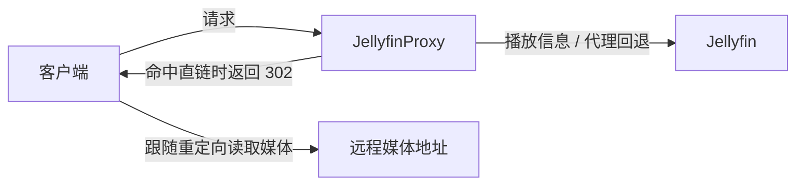

# JellyfinProxy

**面向 Jellyfin 的远程媒体直链代理。**

部署在客户端与 Jellyfin 之间，从播放信息中记录远程媒体地址，让后续视频请求通过
`302` 重定向直连媒体；没有可用直链时，继续由 Jellyfin 提供内容。

[下载 Release](https://github.com/kentinya/JellyfinProxy/releases) ·
[快速开始](#-快速开始) · [配置说明](docs/configuration.md) · [更新记录](CHANGELOG.md)

## ✨ 功能

- **远程媒体直连**：利用 Jellyfin 返回的 HTTP(S) 媒体地址，减少代理中转。
- **HEAD 透传与流式回退**：HEAD 始终按原方法回源 Jellyfin；GET 直链未命中或客户端选择绕过时，透明代理媒体，保留 Range 等响应语义。
- **按客户端控制**：可分别关闭播放信息修改、视频重定向，也可一起绕过。
- **按字段配置**：通过 TOML 覆盖 PlaybackInfo 字段，默认保留 Jellyfin 的字段值。
- **请求日志**：应用日志与访问日志分开，支持请求 ID、认证查询参数脱敏和文件轮转。
- **多种运行方式**：Linux 独立二进制、Docker Compose 或 Python 源码运行。



Jellyfin 负责媒体库和 STRM 解析；JellyfinProxy 只使用返回的媒体信息，不读取 STRM
文件、不运行 ffprobe，也不操作 Jellyfin 数据库。直链播放要求**客户端能访问该媒体地址**。

## 🚀 快速开始

### 使用 Linux 二进制

无需安装 Python。支持 Linux **amd64 / arm64**，需要 glibc 环境；发布构建基线为
Ubuntu 22.04，Alpine / musl 不适用。

1. 从 [Releases](https://github.com/kentinya/JellyfinProxy/releases) 下载对应架构的压缩包及
   `SHA256SUMS.txt`，校验后解压。包内包含 `JellyfinProxy` 和 `JellyfinProxy.toml`。
2. 编辑 `JellyfinProxy.toml`，将 `jellyfin_url` 改为代理主机能够访问的 Jellyfin 地址：

   ```toml
   jellyfin_url = "http://127.0.0.1:8096"
   listen_host = "0.0.0.0"
   listen_port = 8097
   ```

3. 在解压目录启动：

   ```bash
   chmod +x JellyfinProxy
   ./JellyfinProxy --version
   ./JellyfinProxy --config ./JellyfinProxy.toml
   ```

4. 将 Jellyfin 客户端的服务器地址改为 `http://<代理主机IP>:8097`，使用原有 Jellyfin
   账号登录。若使用反向代理或 HTTPS 域名，则填写对应的代理入口。

> [!NOTE]
> 示例配置默认让 **Infuse、Kodi 绕过全部处理**。需要它们使用直链时，请从
> `bypass_clients` 中移除；[客户端策略](#客户端策略)可分别控制播放信息和视频请求。

### 使用 Docker Compose

适用于使用宿主网络的 Linux 主机，需先安装 Git、Docker 与 Compose。

```bash
git clone https://github.com/kentinya/JellyfinProxy.git
cd JellyfinProxy
# 先编辑 JellyfinProxy.toml，设置 Jellyfin 地址和客户端策略
docker compose up -d --build
docker compose logs -f jellyfinproxy
```

默认上游 `http://127.0.0.1:8096` 指宿主机上的 Jellyfin。Compose 从本地源码构建镜像，
挂载当前目录的配置文件；应用日志输出到标准输出，访问日志文件默认关闭。

```bash
docker compose ps                       # 查看状态
docker compose restart jellyfinproxy    # 修改配置后重启
docker compose down                     # 停止并删除容器
```

### 使用 Python 源码

需要 Python **3.11+** 和 Git。

```bash
git clone https://github.com/kentinya/JellyfinProxy.git
cd JellyfinProxy
python3.11 -m venv .venv
.venv/bin/pip install -r requirements.txt
# 先编辑 JellyfinProxy.toml，设置 Jellyfin 地址和客户端策略
.venv/bin/python main.py --config JellyfinProxy.toml
```

## ⚙️ 常用配置

配置文件为 [JellyfinProxy.toml](JellyfinProxy.toml)，修改后需要重启。对应的环境变量优先于
文件配置；完整列表和日志设置见[配置说明](docs/configuration.md)。

| TOML 配置 | 环境变量 | 默认值 | 用途 |
| --- | --- | --- | --- |
| `jellyfin_url` | `JELLYFIN_URL` | `http://127.0.0.1:8096` | Jellyfin 上游地址 |
| `listen_host` | `LISTEN_HOST` | `0.0.0.0` | 代理监听地址 |
| `listen_port` | `LISTEN_PORT` | `8097` | 代理监听端口 |
| `request_timeout_seconds` | `REQUEST_TIMEOUT_SECONDS` | `60` | 上游请求超时，单位秒 |

### 客户端策略

绕过表示“交给 Jellyfin 原样处理”。三个列表分别控制以下行为：

| TOML 配置 | 绕过内容 | 默认值 |
| --- | --- | --- |
| `bypass_clients` | 播放信息修改 + 视频重定向 | `["Infuse", "Kodi"]` |
| `playback_bypass_clients` | 只绕过播放信息修改 | `[]` |
| `video_bypass_clients` | 只绕过视频重定向 | `[]` |

按客户端请求头进行不区分大小写的子字符串匹配，`bypass_clients` 优先级最高。
PlaybackInfo 绕过后仍会记录直链，Video 是否重定向由自己的绕过策略决定。
[查看组合示例与匹配规则 →](docs/configuration.md#客户端绕过)

### 修改播放信息字段

默认不覆盖任何字段。需要将远程媒体源标记为 `File` 并关闭转码声明时，在配置文件末尾
设置以下表；示例文件已有对应空表，直接编辑即可，不要重复添加。

```toml
[playback_info.media_source_fields]
Protocol = "File"
SupportsTranscoding = false
```

这些配置只改变响应中的字段值，实际播放与转码能力仍取决于 Jellyfin 和客户端。
根字段覆盖、类型和作用范围见 [PlaybackInfo 字段覆盖](docs/configuration.md#playbackinfo-字段覆盖)。

## 🔄 未发布变更

- 视频 `HEAD` 请求（`/Videos/{id}/stream` 与 `/Videos/{id}/stream.{container}`）始终按
  HEAD 透传 Jellyfin，不再查询直链映射或返回 302；GET 的直链命中、回退和失效恢复不变。
- 视频直链特殊处理只作用于上述两种路径的 GET / HEAD，`Videos` 与 `stream` 不区分大小写；
  `/video/...`、`master.m3u8`、HLS、字幕及其他子路径改为普通代理，即使携带
  `MediaSourceId` 也不会产生视频 302。
- 视频 GET / HEAD 会在应用日志中记录实际处理方式、映射命中情况和响应状态；新增日志
  不记录查询参数、Cookie 或直链地址。

## 🔄 从 1.0.0 升级到 1.0.1

- `/api/danmu/{id}/raw` 与 `/emby/api/danmu/{id}/raw` 不再使用视频直链映射，改为普通
  代理到 Jellyfin；`/Videos/{id}/...` 等其他视频入口的直链与流式回退保持。
- 原先依赖 raw 路径视频重定向的客户端将收到 Jellyfin 的普通响应；请确认客户端使用的
  播放入口。[升级说明](docs/configuration.md#从-100-升级到-101)包含具体影响。

## 🔄 从 0.9.x 升级到 1.0

- **播放信息每次请求上游**：完整 PlaybackInfo JSON 缓存已撤除；旧缓存配置会被忽略。
- **字段改为显式配置**：不再自动改写 `Protocol="File"` 或禁用转码声明。需要旧效果时，
  使用上面的配置。
- **直链和流式回退保留**：删除的是播放信息正文缓存，用于视频重定向的地址映射仍然存在。

完整迁移说明见[升级说明](docs/configuration.md#从-09x-升级)，版本历史见 [CHANGELOG](CHANGELOG.md)。

## 📚 文档与开发

| 文档 | 内容 |
| --- | --- |
| [配置与播放行为](docs/configuration.md) | 全部配置、客户端策略、字段覆盖、日志、直链规则与常见问题 |
| [构建与发布](docs/releasing.md) | Linux 双架构打包、校验和 GitHub Release 流程 |
| [S1 历史验证与工具](docs/validation/jellyfin-12.3-baseline.md) | 固定 12.3 基线的执行方法、证据范围与工具限制 |
| [开发约束](AGENTS.md) · [开发流程](docs/development-workflow.md) | 参与开发时的角色、实施和审查要求 |
| [当前 Task](TASK.md) · [当前 Slice](SLICE.md) | 当前工作状态 |
| [历史任务与合同](Task/archive/README.md) | 已完成任务、审查记录与合同补充 |

核心代码按职责组织：`routers/` 识别路由，`handlers/` 适配 HTTP，`policies/` 决定客户端策略，
`services/` 处理媒体信息与地址映射，`infrastructure/` 提供上游 HTTP 与日志设施。

版本统一定义在 [version.py](version.py)，可通过 `--version`、启动日志或
`X-JellyfinProxy-Version` 响应头查看。
